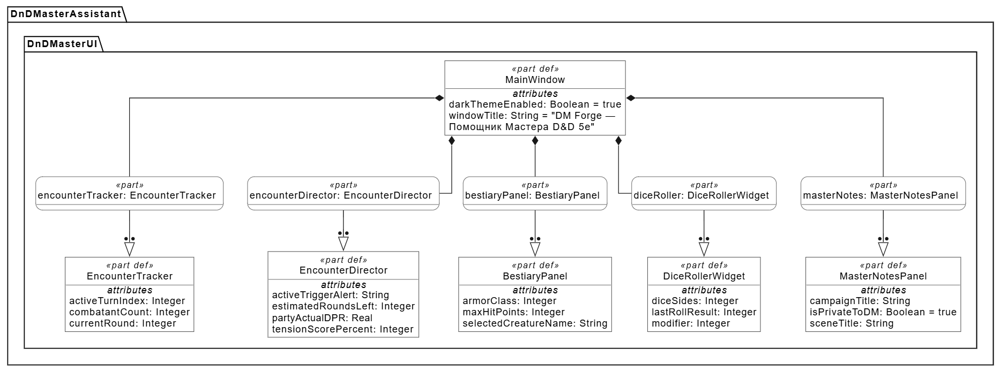
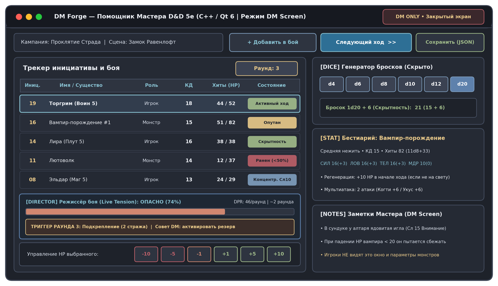

# Спецификация требований программного обеспечения (SRS)
## Проект: DM Forge — Помощник для проведения D&D партий

### 1. Введение и паспорт проекта
* **Название проекта:** DM Forge (Помощник Мастера Подземелий D&D 5e)
* **Тип приложения:** Настольное (Desktop) кроссплатформенное приложение
* **Язык разработки и стек технологий:** C++ (стандарт C++17/C++20), графический фреймворк Qt 6 (Qt Widgets), сборка CMake, локальное хранение данных в форматах JSON / SQLite.
* **Внешние сервисы:** Не используются (полностью автономный режим работы `Offline-First`, не требующий подключения к сети Интернет во время проведения настольных игровых сессий).
* **Язык описания требований и моделей:** Русский язык, Markdown, SysMLv2.

---

### 2. Бизнес-цели, целевая аудитория и уникальное отличие («фишка»)
#### 2.1. Целевая аудитория и бизнес-цели
* **Целевая аудитория:** Мастера Подземелий (Dungeon Masters / DM), проводящие настольные ролевые игры по системе Dungeons & Dragons (5-я редакция) в очном формате за игровым столом или в голосовом чате.
* **Бизнес-цели (проблемы, решаемые продуктом):**
  1. **Ускорение темпа боевых сцен:** сокращение времени на расчёт очередности ходов (инициативы), отслеживание очков здоровья (HP) и статусных эффектов участников боя на 40–50% по сравнению с бумажными записями.
  2. **Информационная закрытость (цифровая ширма Мастера):** обеспечение приватного рабочего пространства Мастера, недоступного для глаз игроков.
  3. **Динамическое удержание драматизма боя без «спойлеров»:** предоставление Мастеру скрытой телеметрии баланса схватки в реальном времени, чтобы избежать случайного уничтожения партии (TPK) или затянутых скучных боёв.

#### 2.2. Уникальное торговое предложение («фишка» проекта) и сравнение с аналогами
Существующие аналоги (*D&D Beyond Encounter Builder*, *Improved Initiative*, *5e.tools*, *Roll20*) представляют собой либо **статичные таблицы** учёта HP, либо требуют постоянного подключения к Интернету и ориентированы на совместный экран с игроками. Главной «фишкой» **DM Forge** является встроенный **«Режиссёр боя и анализатор накала» (`Live Tension & Encounter Director`)**:
* **Анализ реального темпа схватки (`Live Tension Meter`):** вместо статичного расчёта сложности (CR) *до* боя, C++ движок в реальном времени вычисляет фактический средний урон за раунд (DPR) партии и противников, оставшийся запас здоровья сторон и прогнозирует длительность боя, выдавая Мастеру скрытые тактические рекомендации (например, ввод подкрепления или активацию второй фазы босса).
* **Сценарные триггеры по раундам и порогам HP (`Round & HP Triggers`):** Мастер заранее привязывает события (ловушки, прибытие стражи, смену тактики монстра при `HP < 50%`) к номеру раунда или уровню здоровья; система автоматически подсвечивает триггер в нужный момент хода.
* **Автоматический контроль концентрации:** при нанесении урона заклинателю система мгновенно вычисляет сложность спасброска Телосложения (`Сл = max(10, floor(Урон / 2))`) и отображает её прямо в строке участника.

---

### 3. Границы проекта (Scope)
* **Входит в границы системы (In-Scope):**
  * Управление составом участников боевой сцены с автоматической сортировкой по инициативе.
  * Оперативное изменение очков здоровья (HP), учёт КД, состояний и автоматический расчёт Сл проверки концентрации при получении урона.
  * Модуль **Режиссёр боя (`EncounterDirector`)**: расчёт индикатора накала боя (Live Tension), фактического DPR и срабатывание сценарных триггеров по раундам/порогам HP.
  * Встроенный локальный офлайн-бестиарий с просмотром статблоков и добавлением существ в бой в один клик.
  * Генератор скрытых бросков игровых костей (`d4`–`d100`) с модификаторами и журналом бросков.
  * Редактор секретных заметок Мастера с локальным сохранением кампании в JSON/SQLite.
* **Исключено из границ системы (Out-of-Scope):**
  * **Любое взаимодействие со стороны игроков:** игроки не видят экран приложения, не имеют клиентских окон, веб-доступа или второго монитора, подключённого к системе.
  * Сетевой мультиплеер, облачная синхронизация и интеграция со сторонними VTT-платформами.
  * Рендеринг тактической 2D/3D-карты для игроков.

---

### 4. Графическая архитектура и прототипы интерфейса
#### 4.1. Структурная компонентная схема (SysMLv2)
Архитектура пользовательского интерфейса спроектирована на языке SysMLv2 (пакет `DnDMasterUI`). Главное окно `MainWindow` объединяет пять функциональных компонентов: `EncounterTracker`, `EncounterDirector`, `BestiaryPanel`, `DiceRollerWidget` и `MasterNotesPanel`.

#### 4.2. Визуальный UI-мокап главного окна
Макет рабочего окна демонстрирует компоновку закрытого экрана Мастера (`DM ONLY`) с панелью режиссёра боя (`Live Tension`) и триггером текущего раунда:

---

### 5. Варианты использования (Use Cases)
* **UC-01. Подготовка боевой сцены и настройка триггеров:** Мастер добавляет персонажей партии и монстров из локального бестиария, задаёт инициативу и настраивает сценарные триггеры (например, появление подкрепления на 3-м раунде).
* **UC-02. Ведение пошагового боя и контроль концентрации:** Мастер переключает ходы, фиксирует урон/лечение, а система автоматически рассчитывает Сл спасброска концентрации при получении урона.
* **UC-03. Мониторинг накала боя (Live Tension):** По ходу раундов Мастер отслеживает скрытый индикатор реальной опасности схватки и при необходимости применяет подсказки режима «Режиссёр боя».
* **UC-04. Скрытый бросок костей и просмотр бестиария:** Мастер выполняет скрытые проверки за ширмой и обращается к статблокам существ и секретным заметкам.
* **UC-05. Сохранение и восстановление сессии:** Состояние боя, триггеров и заметок сохраняется в локальный файл кампании.

---

### 6. Функциональные требования
* **FR-01 (Трекер инициативы):** Система должна поддерживать добавление, редактирование и удаление участников боя с полями: имя, роль (Игрок / Монстр / NPC), инициатива, КД, текущие/максимальные HP и активные состояния.
* **FR-02 (Сортировка и навигация по раундам):** Система должна автоматически сортировать участников по убыванию инициативы, подсвечивать активный ход и вести счётчик раундов.
* **FR-03 (Управление HP и авторасчёт концентрации):** Система должна предоставлять кнопки быстрого изменения HP (`-10`, `-5`, `-1`, `+1`, `+5`, `+10`) и при нанесении урона участнику со статусом «Концентрация» автоматически вычислять и отображать `Сл = max(10, floor(Урон / 2))`.
* **FR-04 (Локальный бестиарий):** Система должна обеспечивать мгновенный офлайн-поиск и отображение статблоков существ из локальной базы данных.
* **FR-05 (Генератор бросков костей):** Система должна выполнять скрытые броски костей (`d4`–`d100`) с модификатором и отображением детализации.
* **FR-06 (Заметки Мастера):** Система должна предоставлять редактор скрытых заметок, привязанных к текущей кампании и сцене.
* **FR-07 (Локальная сериализация):** Система должна поддерживать сохранение и загрузку состояния кампании в локальный файл JSON.
* **FR-08 (Анализатор накала боя — Live Tension Meter):** Система должна в реальном времени вычислять фактический средний урон за раунд (DPR) сторон, процент оставшегося пула HP, прогнозируемое число раундов до завершения боя и отображать скрытый индикатор угрозы (`Легко`, `Сбалансировано`, `Опасно`, `Смертельно`).
* **FR-09 (Сценарные триггеры боя):** Система должна позволять Мастеру задавать текстовые события-триггеры, привязанные к номеру раунда или порогу HP конкретного существа, и автоматически выводить уведомление при наступлении условия.

---

### 7. Нефункциональные требования и ограничения
* **NFR-01 (Приватность и режим работы):** Приложение функционирует строго в однопользовательском локальном режиме (`DM Screen Only`). Передача данных по сети и вывод отдельного окна для игроков не допускаются.
* **NFR-02 (Производительность и отклик UI):** Время отклика графического интерфейса и пересчёта индикатора накала боя при смене хода или изменении HP не должно превышать `100 мс` при объёме базы бестиария до 1000 существ.
* **NFR-03 (Надёжность и сохранность данных):** Приложение должно выполнять автоматическое резервное сохранение состояния активного боя в локальный файл при каждом переходе к следующему раунду.
* **NFR-04 (Кроссплатформенность):** Приложение должно собираться и корректно работать под управлением ОС Windows 10/11 и Linux (Ubuntu 22.04+) с использованием C++17 и Qt 6.
* **NFR-05 (Эргономика интерфейса):** Графический интерфейс должен использовать тёмную цветовую тему (Dark Mode) с контрастными акцентами для работы при приглушённом освещении.
